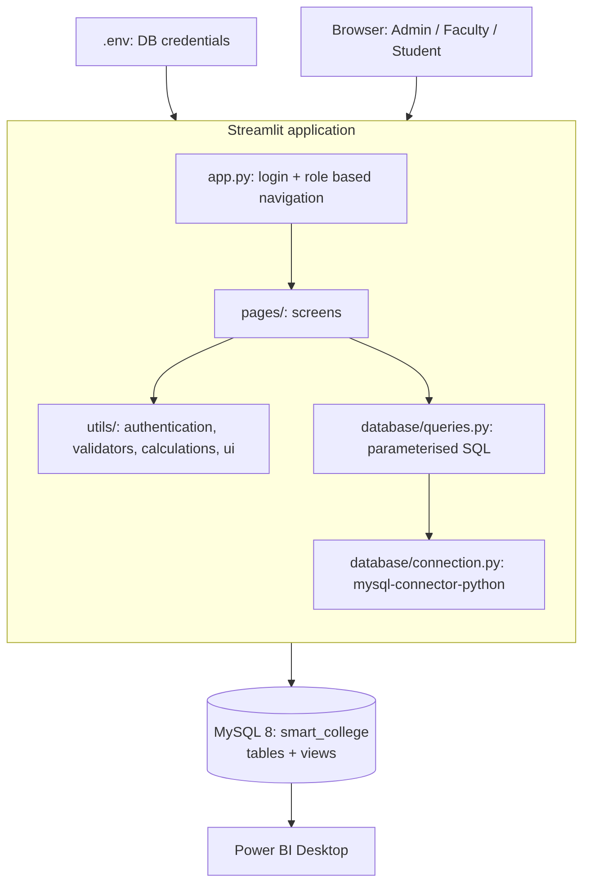
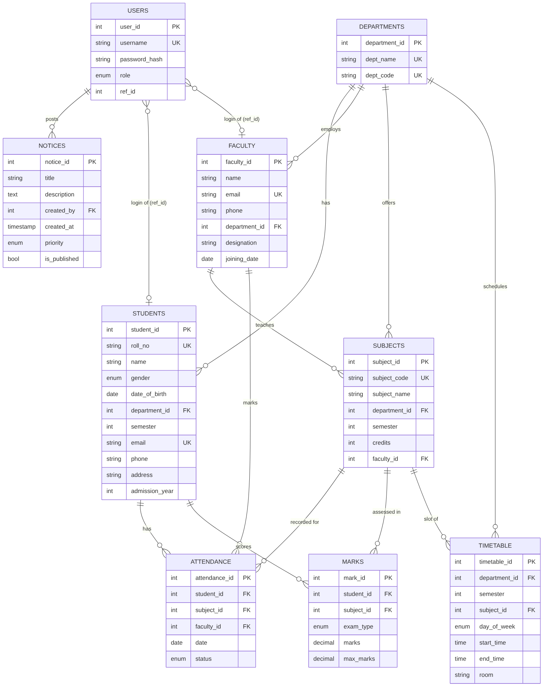
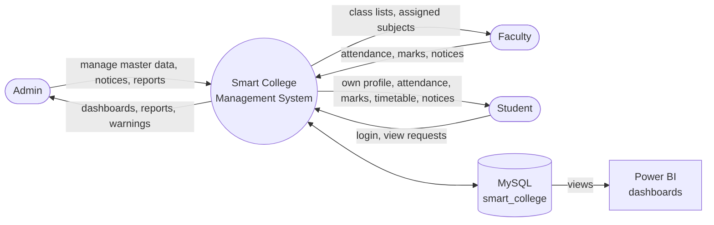
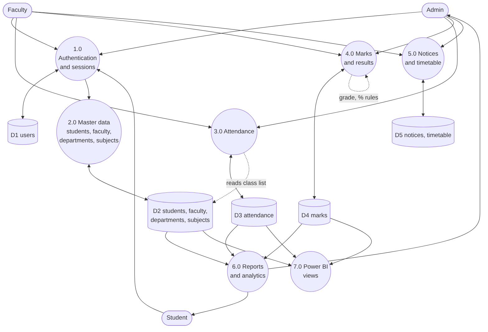
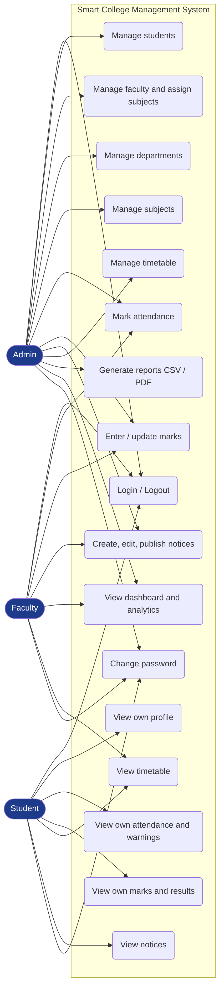

# Diagrams
PNG files are in `docs/diagrams/`. Editable Mermaid sources (`*.mmd`) can be pasted into https://mermaid.live to change and re-export them.

| Diagram | File |
|---|---|
| System architecture | `diagrams/architecture.png` |
| ER diagram | `diagrams/er_diagram.png` |
| DFD level 0 | `diagrams/dfd_level0.png` |
| DFD level 1 | `diagrams/dfd_level1.png` |
| Use case | `diagrams/use_case.png` |

